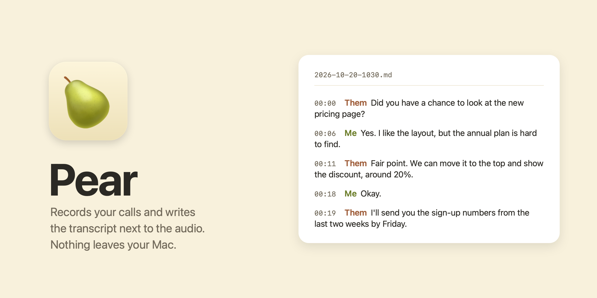

#  Pear



A small Mac app that records your calls and writes the transcript to a Markdown file, with the audio next to it.
Speech recognition runs on your Mac with [Whisper](https://github.com/ggml-org/whisper.cpp): nothing is uploaded,
there is no account and no subscription.

No bot joins the call. Pear records your microphone and whatever your Mac plays, so any call app works: Zoom, Google
Meet, Teams, FaceTime, Telegram, WhatsApp, Slack.

## What it does

- Click the pear in the menu bar, or press **⌃⌥⌘R**, to start. Do it again to stop. While it records, the menu bar
  shows the time in red: 
- Your microphone and the Mac's sound output are recorded as two separate tracks, so the transcript knows who said
  what: **Me** and **Them**. Nothing is guessed from voices.
- When you stop, the call is transcribed on your Mac and a notification opens the transcript. A 6-minute call was
  ready in under a minute on an M2 Pro; plan on roughly 5 to 6 minutes per hour of talk.
- Each side's language is detected on its own, so a call where you speak Russian and they speak English comes out
  right on both sides.
- You get two files per call, in `~/Documents/Pear` (choose another folder in the menu):
  - `2026-10-20-1030.md`: the transcript, with timestamps
  - `2026-10-20-1030.m4a`: the audio, you on the left channel and them on the right

### A transcript looks like this

```markdown
# Call 2026-10-20 10:30

- **When:** 2026-10-20, 10:30–10:30 (30 s)
- **Audio:** [2026-10-20-1030.m4a](2026-10-20-1030.m4a) (left channel: me, right channel: them)
- **Language:** me: en, them: en

---

**[00:00] Them:** Hi, thanks for jumping on. Did you have a chance to look at the new pricing page?

**[00:06] Me:** Yes, I did. I like the layout, but the annual plan is hard to find.

**[00:11] Them:** Fair point. We can move it to the top and show the discount, around 20%.

**[00:18] Me:** Okay.

**[00:19] Them:** I'll also send you the sign-up numbers from the last two weeks by Friday.

**[00:25] Me:** Perfect, thanks. Talk soon.
```

Plain Markdown, so it opens anywhere and you can hand it to ChatGPT or Claude for a summary.

## Requirements

- A Mac with Apple Silicon and macOS 15 or later (built and tested on macOS 26 with an M2 Pro)
- Xcode Command Line Tools: `xcode-select --install`
- [Homebrew](https://brew.sh)
- About 2 GB of disk for the speech model and tools

## Install

```bash
git clone https://github.com/olevasyliev/pear ~/pear
cd ~/pear
./install.sh
```

The installer adds whisper.cpp and ffmpeg through Homebrew, downloads the speech models (1.6 GB, once) into
`~/Library/Application Support/Pear`, builds **Pear.app** from source into `/Applications` and opens it.

Using a coding agent? Tell Claude Code, Codex or Cursor: *"install Pear from github.com/olevasyliev/pear"*. It's one
script.

### Permissions (once)

macOS asks for these the first time you record:

- **Microphone**: your side of the call.
- **System audio recording**: the other side. It sits under *Privacy & Security → Screen & System Audio Recording*.
  Pear takes only the sound, never the screen.
- **Notifications**: the "Transcript ready" message.
- **Files in Documents** (or wherever your calls folder is).

If the other side is missing from a transcript, check *Screen & System Audio Recording → Pear*. The transcript also
says so when the Mac's sound output was silent for the whole call.

## How it works

```
your microphone ──────┐                               ┌─▶ 2026-10-20-1030.md
                      ├─▶ Pear.app ──▶ transcribe.py ─┤
what your Mac plays ──┘   (menu bar)   (whisper.cpp)  └─▶ 2026-10-20-1030.m4a
```

- The other side is captured with a Core Audio process tap, built into macOS. No virtual audio driver (no BlackHole),
  nothing to set up in Audio MIDI Setup.
- Each side's speech is found with [Silero VAD](https://github.com/snakers4/silero-vad) and grouped wherever the other
  side talks. Whisper large-v3-turbo transcribes each side in one pass, and every word goes back to its real time, so
  the lines come out in the order they were said.
- On speakers instead of headphones, your microphone also hears the other side. Pear finds those echoed words and
  drops them. Headphones still give the cleanest result.
- Raw audio waits in a hidden `.raw.nosync` folder until it's transcribed, and Pear picks up anything left there the
  next time it starts. If transcription fails, the audio stays, with a log next to it.

## Known limits

- Everyone on the other side is **Them**. Pear doesn't tell three or more people apart yet.
- Very short replies such as "uh-huh" are sometimes missed.
- English words inside other languages can come out spelled the local way (an "MCP" in a Russian call may come out in
  Cyrillic).
- Switching audio devices mid-call (AirPods connecting or dropping) restarts the capture on the new device, but this
  hasn't been tested much yet.
- Apple Silicon only.

## Tell people you're recording

Pear doesn't announce itself in the call. In many countries recording a conversation without consent is illegal, so
say it out loud before you start.

## Update and uninstall

```bash
cd ~/pear && git pull && ./install.sh   # update
./uninstall.sh                          # remove the app, models, settings and permissions; your calls stay
```

## Feedback

Missing something? [Open an issue](https://github.com/olevasyliev/pear/issues) or send a pull request.

## Credits

[whisper.cpp](https://github.com/ggml-org/whisper.cpp) with OpenAI's Whisper large-v3-turbo model,
[Silero VAD](https://github.com/snakers4/silero-vad) and [FFmpeg](https://ffmpeg.org).

## License

MIT
